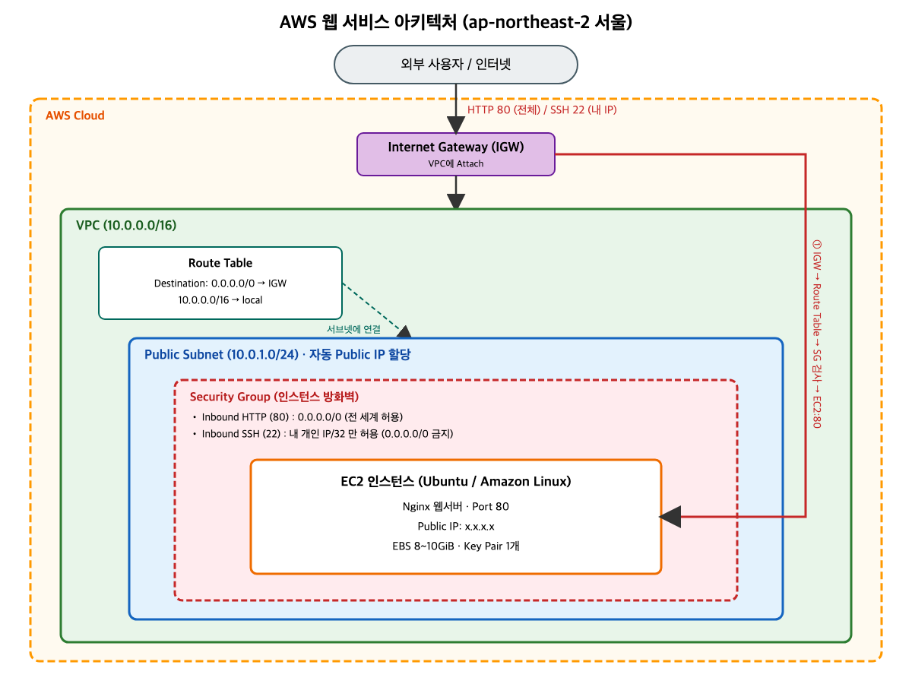

# 아키텍처 다이어그램

> 제출물: `docs/architecture.png` (원본 `architecture.svg`)



## 트래픽 흐름

외부 사용자 → Internet Gateway → Route Table(0.0.0.0/0 → IGW) → Public Subnet → Security Group(80 허용) → EC2(Nginx)

```
[ 외부 사용자 / 인터넷 ] (Internet)
         │
         │ (HTTP: 80 / SSH: 22)
         ▼
+---------------------------------------------------------------------------------+
│ AWS Cloud (Region: ap-northeast-2 서울)                                          │
│                                                                                 │
│  [ 인터넷 게이트웨이 (IGW) ] <----------------+                                  │
│         │                             │                                         │
│         │ (0.0.0.0/0 경로 연결)       │                                         │
│         ▼                             │                                         │
│  [ VPC (10.0.0.0/16) ]                │                                         │
│   │                                   │                                         │
│   ├── [ 라우팅 테이블 (Route Table) ] --+                                         │
│   │      └─ Destination: 0.0.0.0/0 ──> IGW                                      │
│   │                                                                             │
│   └── [ 퍼블릭 서브넷 (Public Subnet: 10.0.1.0/24) ]                            │
│        │                                                                        │
│        │ (자동 Public IP 할당)                                                  │
│        ▼                                                                        │
│  +---------------------------------------------------------------------------+  │
│  │ 보안 그룹 (Security Group)                                                │  │
│  │  - 인바운드 HTTP (포트 80): 0.0.0.0/0 (전 세계 허용)                      │  │
│  │  - 인바운드 SSH (포트 22): 내 개인 IP만 허용 (0.0.0.0/0 금지)             │  │
│  +---------------------------------------------------------------------------+  │
│        │                                                                        │
│        ▼                                                                        │
│  +---------------------------------------------------------------------------+  │
│  │ EC2 인스턴스 (Ubuntu / Amazon Linux)                                      │  │
│  │  - Nginx 웹서버 구동 (Port 80)                                            │  │
│  +---------------------------------------------------------------------------+  │
│                                                                                 │
+---------------------------------------------------------------------------------+
```

## 구성 요소 역할

| 구성 요소 | 값 | 역할 |
|---|---|---|
| VPC | 10.0.0.0/16 | 격리된 가상 네트워크 |
| Public Subnet | 10.0.1.0/24 | 퍼블릭 IP를 가진 인스턴스가 위치하는 대역 |
| Internet Gateway | VPC에 attach | VPC와 인터넷 간 통로 |
| Route Table | 0.0.0.0/0 → IGW | 서브넷의 외부 트래픽 경로 지정 |
| Security Group | 80: 0.0.0.0/0, 22: 내 IP | 인스턴스 단위 방화벽(인바운드 제어) |
| EC2 | Nginx (80) | 웹 서비스 실행 |
